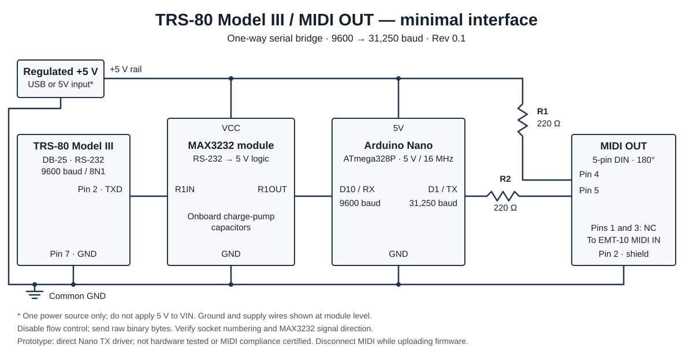

# TRS-80 Model III RS-232 to MIDI OUT

This external, one-way interface lets the Model III send the live Space Invaders four-note march to a Yamaha EMT-10, while the cassette port continues to produce the original game sound effects. No modification to the Model III is required, but its RS-232 option must be installed and working.



## Signal path

```text
Model III DB-25 TXD (9600 baud, 8N1)
    -> MAX3232 RS-232 receiver / 5 V logic
    -> Arduino Nano D10 (SoftwareSerial RX)
    -> Nano D1 (hardware UART TX, 31250 baud, 8N1)
    -> 220 ohm MIDI OUT current-loop circuit
    -> 5-pin DIN MIDI cable -> Yamaha EMT-10 MIDI IN

Model III cassette output -> separate amplifier or audio mixer
EMT-10 audio output      -> separate amplifier or audio mixer
```

The Model III's serial baud rate is different from MIDI's. The Nano translates the byte transmission rate; the MAX3232 converts RS-232 voltage levels to logic. **Never connect RS-232 directly to the MIDI input or Nano logic pins.**

## Parts

| Qty | Component |
| --- | --- |
| 1 | Classic Arduino Nano, ATmega328P, 5 V, 16 MHz |
| 1 | MAX3232 module rated for 5 V, with onboard charge-pump capacitors |
| 2 | 220 ohm, 1/4 W resistors |
| 1 | Female 180-degree 5-pin DIN MIDI OUT socket |
| 1 | Mating DB-25 serial connector or breakout |
| 1 | Regulated 5 V supply, at least 200 mA, or USB power |
| As needed | Wire, board, enclosure and MIDI cable |

## Wiring

| From | To |
| --- | --- |
| Model III DB-25 pin 2 (TXD) | MAX3232 R1IN (RS-232 receive input) |
| Model III DB-25 pin 7 (signal ground) | Common GND |
| MAX3232 R1OUT (logic receive output) | Nano D10 |
| Nano 5V | MAX3232 VCC |
| Nano GND | MAX3232 GND and MIDI OUT DIN pin 2 |
| Nano 5V | 220 ohm R1 -> MIDI OUT DIN pin 4 |
| Nano D1/TX | 220 ohm R2 -> MIDI OUT DIN pin 5 |

Leave DIN pins 1 and 3 and Nano D11 unconnected. Confirm the socket's terminal numbering from its datasheet; do not infer the solder-side positions from a front view. Verify the MAX3232 module signal direction rather than trusting ambiguous TX/RX labels.

Power via USB or a suitable regulated 5 V rail at 5V (not VIN). Do not drive the rail from two supplies simultaneously. No power is taken from the TRS-80 serial port. The direct Nano TX design is the minimal prototype from the companion project; it is not a certified MIDI electrical interface. A properly buffered MIDI OUT conforming to the MIDI Association specification is preferred for production. MIDI IN isolation is provided by the receiving instrument. Do not tie cassette or MIDI signal wiring together; mix the two **audio** outputs using a suitable audio mixer.

## Nano firmware

[Open the included MIDISD fast v0.3 sketch](../firmware/serial_to_midi_fast/serial_to_midi_fast.ino). It is a snapshot of the companion MIDI project, with no game-specific firmware changes.

1. Open the sketch in Arduino IDE and select Arduino Nano, ATmega328P, the appropriate bootloader and USB port.
2. Disconnect the MIDI cable while uploading/resetting; bootloader activity on D1 is not musical data.
3. Upload using the standard AVR core and its built-in SoftwareSerial library.
4. After boot, reconnect MIDI OUT to EMT-10 MIDI IN. Set the receiver to channel 1 or OMNI and connect the audio output.
5. Start the game with M + SPACE at the splash, using the newly assembled CMD. SPACE alone retains the original cassette-only soundtrack.

The firmware starts in RAW mode: immediate FIFO forwarding of channel messages. The 512-byte FIFO is shared with the timed MIDISD modes, but the game does not send timed START/tick tokens and does not use their nominal 160 ms lookahead. This avoids deliberately delaying live game notes. Reserved transport bytes FD/F9/F8/FA/FC are not used by the game. If previously playing timed files or after a firmware fault, reset the Nano before launching the game. The LED is off in normal raw mode, steady on a fault and blinking during timed playback. The RAW mode has no link watchdog; a disconnected cable or incomplete note-off may require manually silencing the EMT-10. Do not print diagnostic text to D1.

## Model III Z80 interface

| Port | Function in the game |
| --- | --- |
| E8h | UART reset (write 00h) |
| E9h | Baud selection (write EEh for 9600) |
| EAh | UART control (write 6Fh); read bit 6 for transmit ready |
| EBh | Transmit raw byte |
| FFh | Original cassette audio |

The game polls transmit-ready with a bounded retry loop. The existing formation speed accumulator determines the note trigger; the EMT-10 uses channel 1, native program 64 (Electric Bass + Piano 1 split), velocity 90, and notes 43, 41, 39, 36, all below the split. The game explicitly releases notes at pulse expiry, next step and gameplay exits. No new delays are scheduled by the bridge in RAW mode. The original cassette SFX routines are independent of the serial bridge.

## First test

- With the receiver disconnected, check the regulated 5 V supply and Nano D1 idle-high state after boot. If possible verify 9600 baud at D10 and 31250 baud at D1 with a logic analyser.
- Send raw bytes `C0 40` (program 64), `90 2B 5A` (G2 on), then `80 2B 00` (G2 off) from the Model III with a short pause between note-on and note-off. Do not send ASCII hex strings.
- Assemble the game with zmac; test SPACE-only, M+SPACE, movement-synchronised notes, increasing pace, wave transition, player death and BREAK. Check both audio outputs independently.

The companion project's fast firmware has successful physical Model III/EMT-10 playback reported for MIDISD. That does not establish that this game's integration has been tested: its updated source still needs assembly and emulator/physical hardware regression. The checked-in CMD and LDOS disk remain older cassette-only builds.

## Source, attribution and maintenance

The central MIDI development repository is [TRS-80 Model III Simple MIDI Out](https://github.com/royedmund/TRS-80-Model-III-Simple-Midi-Out). The circuit and Nano firmware in this fork are local copies from its commit [0d3495e](https://github.com/royedmund/TRS-80-Model-III-Simple-Midi-Out/commit/0d3495eddf8c5f28940ab5743f745007e164d29d):

- [Original schematic](https://github.com/royedmund/TRS-80-Model-III-Simple-Midi-Out/blob/0d3495eddf8c5f28940ab5743f745007e164d29d/hardware/minimal-midi-out.svg)
- [Original fast Nano sketch](https://github.com/royedmund/TRS-80-Model-III-Simple-Midi-Out/blob/0d3495eddf8c5f28940ab5743f745007e164d29d/player/firmware/serial_to_midi_fast/serial_to_midi_fast.ino)

The included schematic retains the original drawing's prototype-status wording; the companion project's later MIDISD playback report is separate evidence. The copied schematic and firmware are MIT-licensed; see [their license notice](MIDI-INTERFACE-LICENSE.txt). This notice applies to those copied MIDI materials only, not to the upstream Space Invaders game. Tim Walter / TechPrototyper's original game credit is preserved. Maintain the firmware centrally and refresh this local snapshot when needed.

References: [MIDI Association 5-pin DIN electrical specification](https://midi.org/5-pin-din-electrical-specs), [Yamaha EMT-10 user's guide](https://ru.yamaha.com/files/download/other_assets/2/320652/EMT10E.PDF), [TRS-80 ports and I/O](https://www.trs-80.com/main-internal-ports-and-i-o.htm).
